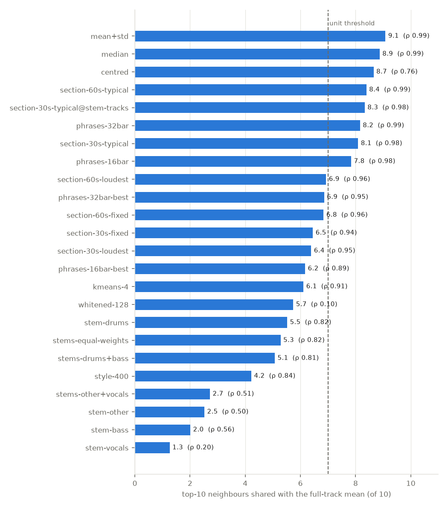
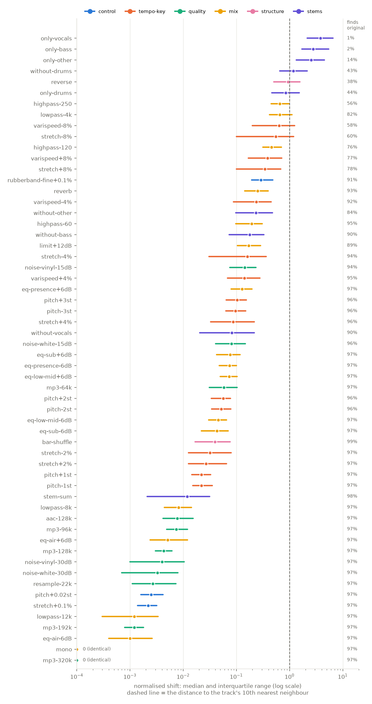
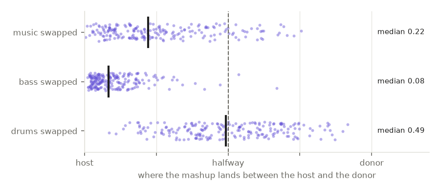
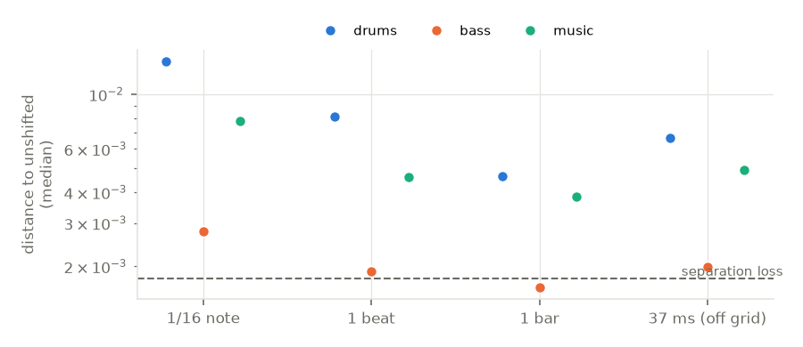
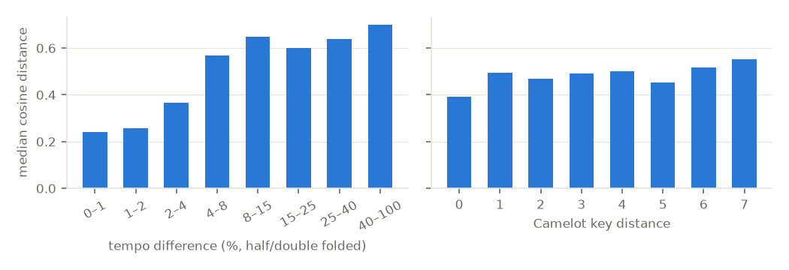

# What Discogs-EffNet hears: findings

Model: `discogs_multi_embeddings-effnet-bs64-1` (the analyser's `.pb`), measured on full tracks from the AKIN catalog
(7,881 tracks; drum & bass is the largest genre). All numbers are aggregates from `$EPR_OUT/report/summary.json`; the tooling is
`analyser/research/effnet-perception/`, the design is `design.md`, and the literature notes are `literature.md`.
The listening page with the examples is local: `/Volumes/DJ/research/effnet-perception/page/index.html`.

## In short: what the model listens to

1. **Drums first.** Removing the drums moves a track further than any mix change (normalised shift 1.17; the
   original is found again only 43 % of the time). In a stem swap, donor drums pull the mashup halfway to the donor
   (median position 0.49, and 49 % of mashups end up nearer the donor). The drums alone keep more of the mean's
   neighbourhood (5.5 of 10) than any other stem.
2. **Bass and music matter much less, and vocals least.** Swapping the bass barely moves the mashup (position 0.08);
   swapping the music (the "other" stem) moves it to 0.22. Removing the vocals shifts a track by 0.08 — about as much
   as a 2-semitone pitch shift.
3. **Tempo is encoded; key is barely encoded.** Time-stretching by 8 % moves a track 0.34–0.55 of the way to its
   10th neighbour and breaks self-retrieval for 22–40 % of tracks. Across the catalog, pairs within 2 % BPM have a
   median distance of 0.24–0.26 against 0.57 at 4–8 %. Pitch-shifting by ±3 semitones moves only 0.10, Camelot key
   distance has almost no relation to embedding distance (ρ 0.05), and a linear probe gets key right 16 % of the time
   (chance 4 %).
4. **Spectral balance below 8 kHz matters; anything above is invisible.** High-pass at 120 Hz (0.45) and 250 Hz (0.66)
   and low-pass at 4 kHz (0.65) are among the largest single changes. Low-pass at 8 or 12 kHz, ±6 dB "air" EQ,
   resampling to 22 kHz and MP3 at ≥ 96 kbps are near zero. Mono is exactly zero. This is by construction: the model
   sees 16 kHz mono audio, so nothing above 8 kHz and no stereo information reaches it.
5. **Structure is largely ignored, direction is not.** Shuffling the bars barely moves a track (0.04), and offsets
   between stems are small (≤ 0.08 normalised). Reversing the audio moves it as far as its 10th neighbour (0.94).
   The mean embedding is a texture summary: which sounds occur, not in which order.
6. **Genre and tempo explain half of the closeness.** In a joint model over 300,000 catalog pairs, shared genre and
   BPM difference explain R² 0.52 of the distance (standardised coefficients −0.46 and +0.28). Energy difference adds
   a little (+0.17), and key, label and artist almost nothing once genre is known.

## Part 1: track representations

Part 1 is descriptive by choice: it shows how far each representation's neighbours differ from the mean's, not
which is "better".

| Representation | Top-10 shared with mean | ρ (all pairs) |
|---|---|---|
| mean ⊕ std | 9.1 | 0.99 |
| median | 8.9 | 0.99 |
| centred (catalog mean removed) | 8.7 | 0.76 |
| section, 60 s, most typical | 8.4 | 0.99 |
| phrases, 32 bars (grid tracks) | 8.2 | 0.99 |
| **section, 30 s, most typical (Part 2 unit)** | **8.1** | **0.98** |
| phrases, 16 bars (grid tracks) | 7.8 | 0.98 |
| section, 30/60 s, loudest or fixed position | 6.4–6.9 | 0.94–0.96 |
| best-matching phrase / k-means (4) multi-vector | 6.1–6.9 | 0.89–0.95 |
| PCA-whitened (128) | 5.7 | 0.10 |
| style probabilities (400) | 4.2 | 0.84 |
| stems (unit only, 200 tracks) | drums 5.5, bass 2.0, other 2.5, vocals 1.3 | 0.20–0.82 |

Observations:
- **The mean is stable.** Median and mean ⊕ std keep 9 of 10 neighbours. The patch distribution of a track is
  compact, so its centre is well defined; the spread adds little.
- **A well-chosen 30 s keeps most of the neighbourhood.** The most typical 30 s window (the one closest to the
  track's own mean) keeps 8.1 of 10; a fixed position or the loudest window keeps only 6.4–6.9. That is why Part 2
  uses the typical 30 s, and it means a short excerpt can stand in for the full track **if it is chosen by
  typicality**, not by position.
- **Whitening reshuffles everything (ρ 0.10).** Equalising the variance of all directions throws away the dominant
  axes (genre, tempo), and its gained neighbours differ more in BPM (median 2.9 % against 1.9 % for the lost ones).
- **Style probabilities are a coarser, different space** (4.2 of 10): gained neighbours differ more in BPM (2.9 % vs
  1.5 %).
- **Stems.** The stems cover only the 30 s unit. On the same 200 tracks the unit section itself keeps 8.3 of 10, so
  the drop to 5.5 (drums) and lower comes from the separation, not from the section. The concatenation of all four
  stems (5.3) is no closer to the mix than the drums alone, which again says the mix embedding is drum-led.
- **Crates.** Nearly every alternative loses more same-crate neighbours than it gains (for example section-30s:
  13.8 % lost vs 11.4 % gained; style: 16.6 % vs 8.8 %). With no ground truth this is only a hint, but it suggests
  the full-track mean is at least as close to how the tracks were crated as any alternative tried.

## Part 2: what moves an embedding

**Normalised shift** = cosine distance from the original ÷ distance from the original to its own 10th nearest
neighbour in the 500-track reference set (median 0.183). A shift of 1 moves a track as far as its 10th neighbour.
**Finds original** = the changed track's nearest neighbour in the reference set is the original. The baseline is
96.7 %, not 100 %, because 28 of the 500 reference tracks have an exact duplicate in the catalog.

300 tracks, 30 s unit each, about 50 changes per track; 200 tracks for the stem changes. Two changes were excluded
for tracks where the change did not happen: resample-22k (67 tracks with nothing above 11 kHz) and limit+12dB
(73 masters already so limited that +12 dB lowered the crest factor by less than 1.5 dB).

| Group | Change | Shift (median) | Finds original |
|---|---|---|---|
| Controls | stretch +0.1 %, pitch +0.02 st (sox) | 0.002 | 97 % |
| | rubberband R3 +0.1 % | **0.29** | 91 % |
| Tempo | stretch ±2 % / ±4 % / ±8 % | 0.03 / 0.09–0.16 / 0.34–0.55 | 97 / 94–96 / 60–78 % |
| | varispeed ±4 % / ±8 % | 0.14–0.24 / 0.39–0.63 | 92–95 / 58–77 % |
| Key | pitch ±1 / ±2 / ±3 semitones | 0.02 / 0.05 / 0.10 | 96–97 % |
| Codec | MP3 320 / 192 / 128 / 96 / 64 kbps, AAC 128 | 0 / 0.001 / 0.004 / 0.007 / 0.058, 0.008 | 97 % |
| Noise | white / vinyl at 30 dB SNR; at 15 dB | 0.003–0.004; 0.08–0.14 | 97 %; 94–96 % |
| Filters | low-pass 12k / 8k / 4k | 0.001 / 0.008 / 0.65 | 97 / 97 / 82 % |
| | high-pass 60 / 120 / 250 Hz | 0.19 / 0.45 / 0.66 | 95 / 76 / 56 % |
| EQ ±6 dB | sub, low-mid, presence, air | 0.04–0.08, 0.05–0.07, 0.07–0.13, 0.001–0.005 | 97 % |
| Dynamics, space | limiter +12 dB, reverb | 0.17, 0.25 | 89 %, 93 % |
| Stereo | mono | 0 | 97 % |
| Structure | bar shuffle, reverse | 0.04, 0.94 | 99 %, 38 % |
| Stems | stem sum (separation control) | 0.012 | 98 % |
| | without drums / bass / other / vocals | 1.17 / 0.18 / 0.23 / 0.08 | 43 / 91 / 85 / 90 % |
| | only drums / bass / other / vocals | 0.84 / 2.80 / 2.55 / 3.78 | 45 / 3 / 14 / 1 % |

Observations:
- **Slowing down moves more than speeding up** (stretch −8 %: 0.55, +8 %: 0.34; varispeed likewise). The cause was
  not examined; one candidate is that tempo classes are not evenly spaced in the catalog.
- **Varispeed ≈ stretch + pitch**, slightly more than the stretch alone, consistent with tempo dominating key.
- **EQ boosts move more than cuts** of the same size, and presence (2–5 kHz) is the most sensitive band below 8 kHz.
  Sub-bass changes matter less than a 60–120 Hz high-pass, which removes the kick's body as well.
- **Codecs are harmless at normal bitrates.** Only 64 kbps MP3 is measurable (0.06), and it still never changes
  retrieval. For 128 kbps MP3 previews the codec is not a concern; which section the preview covers is.

### Stretch engines: a trap for any tempo experiment

Rubber Band's R3 engine (`--fine`) moved the embedding by 0.29 at an inaudible 0.1 % tempo change: over 100× more
than sox WSOLA at the same ratio (0.002), and almost as much as a real 8 % stretch (0.34). The R2 engine sat in between (0.008–0.04 in
the trial). All tempo and pitch numbers here therefore come from sox, with the near-zero controls in the table
showing that the engine itself adds almost nothing. Any tempo augmentation or tempo matching before embedding should
use a transient-preserving time-domain stretcher, or measure its own artefact first.

### Stem swaps

200 host–donor pairs within ±15 % BPM (median host–donor distance 0.46); the donor stem is tempo-matched with sox,
cut to the host's bars and level-matched. Position 0 = the mashup embeds like the host, 1 = like the donor.

| Swapped layer | Median position | IQR | Nearer the donor |
|---|---|---|---|
| drums | 0.49 | 0.37–0.65 | 49 % |
| music (other + vocals) | 0.22 | 0.11–0.38 | 13 % |
| bass | 0.08 | 0.04–0.14 | 1 % |

### Stem offsets

50 tracks with a beat grid; one layer delayed against the others, compared with the unshifted recombination of the
same stems (so separation loss cancels out). Separation loss itself (mix vs stem sum) is 0.0018 (residual −20 dB).

| Layer | 1/16 note | 1 beat | 1 bar | 37 ms (off grid) |
|---|---|---|---|---|
| drums | 0.0136 | 0.0081 | 0.0046 | 0.0066 |
| music | 0.0078 | 0.0046 | 0.0038 | 0.0049 |
| bass | 0.0028 | 0.0019 | 0.0016 | 0.0020 |

The assumption holds: the model hardly cares about offsets. The largest (drums by a 1/16 note) is 0.074 normalised,
about a 2-semitone pitch shift. For every layer a 1/16-note offset moves most and a one-bar offset least; a
one-bar offset of the bass is indistinguishable from separation loss.

## Part 3: what explains closeness across the catalog

AKIN's stored means match the recomputed ones (40 tracks, minimum cosine 0.999), so the catalog-wide analysis uses
all 7,879 stored means over 300,000 sampled pairs.

| Factor | Spearman ρ with distance | Median distance (same / different) |
|---|---|---|
| shared genre | −0.67 | 0.24 / 0.62 |
| BPM difference (folded) | +0.62 | — |
| shared crate | −0.36 | 0.27 / 0.47 |
| energy difference | +0.18 | — |
| shared label | −0.08 | 0.19 / 0.36 |
| shared artist | −0.06 | 0.16 / 0.47 |
| Camelot key distance | +0.05 | — |

Shared label and artist have small ρ only because such pairs are rare (843 and 631); when they occur, those pairs are
the closest of all (0.19 and 0.16), as the training (artist weight 0.6) predicts.

Linear probes (cross-validated, chance in brackets):
- genre: balanced accuracy 0.48 (0.04), 23 classes;
- label: 0.34 (0.03), 40 classes;
- key: 0.16 (0.04), 24 classes; mode 0.57 (0.50);
- BPM: R² 0.46, MAE 21 BPM against 35 for the mean; within 4 % (folded) for only 24 % of tracks.

Tempo is present as a broad "tempo class" rather than an exact value, and key is close to absent, in line with
MusiCNN-family results in the literature.

## What this means for fomoplayer

- **Previews vs full tracks.** A 30 s excerpt reproduces 8 of 10 full-track neighbours when it is the track's most
  typical part, but only 6.4 when taken at a fixed position or at the loudest point. Codec quality is irrelevant
  above 96 kbps. If full tracks are available, the best short input is the most typical window, not a preview at a
  fixed offset; that also cuts the stem separation time (one region instead of the whole track).
- **Similarity search is drum- and tempo-led.** Neighbours share genre, tempo class and drum sound; key, melody and
  vocals barely count. A key-aware or melody-aware search needs another feature (key from the catalog, or a
  separate embedding of the "other" stem).
- **Pre-processing must be clean.** Keep the input band ≥ 8 kHz and do not high-pass; never time-stretch with a
  phase-vocoder engine before embedding.
- **Representations.** Median or mean ⊕ std are drop-in equivalents of the mean. Whitening or the style head would
  change the search substantially and would need user evaluation (design D) before use.

## Caveats

- One genre dominates the catalog (70 % of the genre-labelled tracks the probe used), so catalog-wide correlations
  partly reflect where other genres sit in tempo. The samples are stratified by crate and genre.
- The Part 1 stem representations cover the 30 s unit, not the whole track, and their per-stem embeddings were made
  before the per-track stem gain was added (stem sums 2–21 % quieter than the mix). Swaps, offsets and stem changes
  use the gain-corrected stems.
- Part 1 has no ground truth, by design: "overlap with the mean" measures difference, not quality.
- Demucs artefacts are part of every stem result; the stem-sum control (0.012) bounds them.
